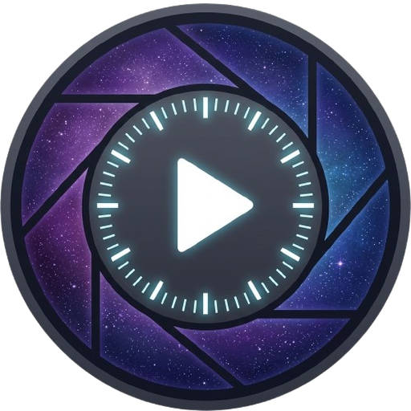
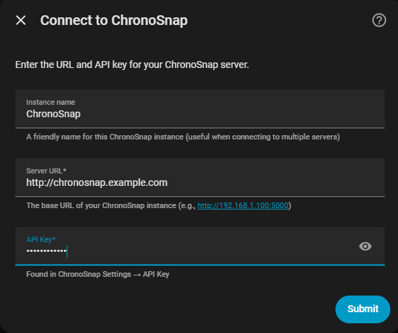
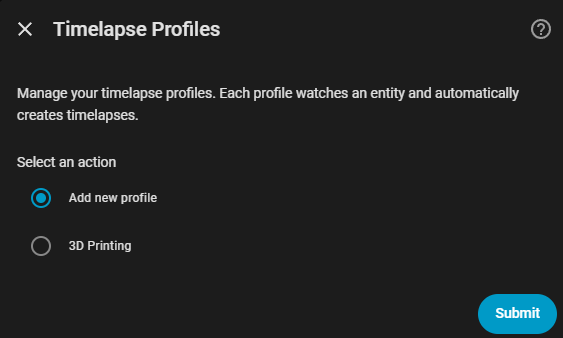
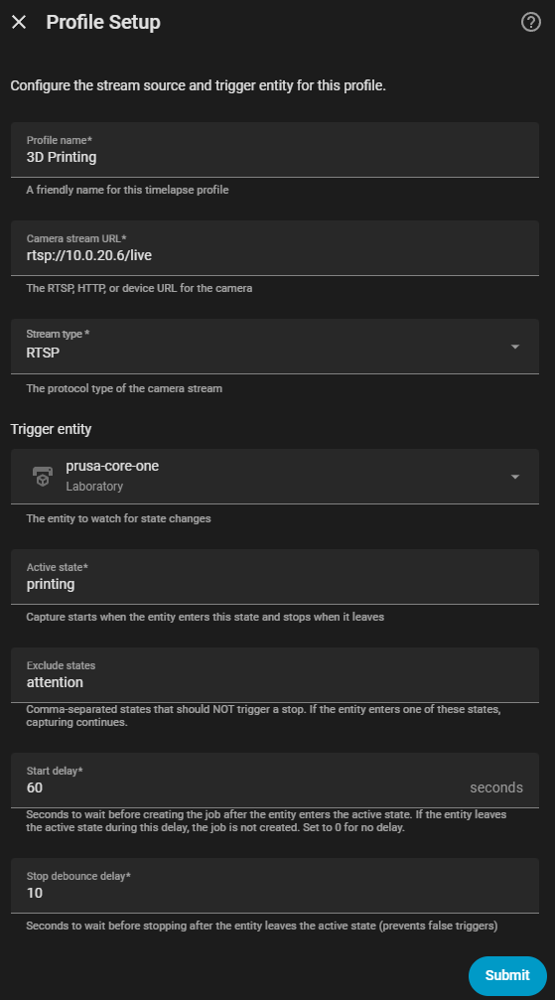
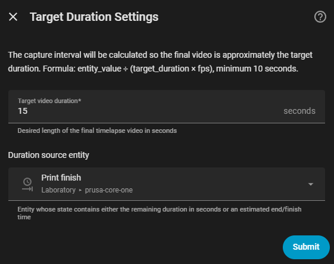
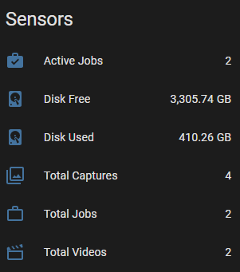

#  +  ChronoSnap for Home Assistant

[](https://github.com/hacs/integration)

A Home Assistant custom integration for [ChronoSnap](https://github.com/kernelkaribou/chronosnap) that turns entity state changes into automated timelapses.

## Examples

- Timelapse every 3D print from start to finish, triggered by your printer's status entity
- Capture what your dog gets up to when the house is detected as empty
- Timelapse your backyard camera as a storm rolls through, triggered by a weather sensor
- Timelapse your garage workbench whenever a presence sensor detects someone in the shop
- And more ...

## Features

- **UI-based configuration** - no YAML editing required
- **Entity selectors** - pick any entity and enter its raw trigger state from Developer Tools > States
- **Multiple profiles** - run different timelapses simultaneously on different cameras
- **Flexible capture intervals:**
  - **Fixed** - capture every N seconds (minimum 10s)
  - **Target duration** - automatically calculate the interval from a duration entity so the final video is a specific length
- **Start delay** - configurable grace period before creating a job, cancels if the entity leaves the active state during the delay
- **Stop debounce** - configurable delay before stopping to prevent false triggers from brief state changes
- **Exclude states** - define temporary states that should not interrupt an active capture
- **Tags** - apply ChronoSnap tags to jobs and videos (fetched from your server)
- **Capture and video quality** - independent quality settings for captured frames and output video
- **Resolution control** - set the output video resolution
- **Per-profile controls** - arm/disarm automatic timelapses without reloading other profiles; explicitly start mid-process or retry recovery
- **Selectable failed-build retention** - preserve source frames by default, or automatically discard them after a confirmed failed build
- **Auto-cleanup** - optionally delete the capture job and raw frames after building; existing video records are preserved
- **Per-profile devices** - each profile has controls, status, and a live capture count
- **Restart recovery** - recording phases, original settings, job IDs, and video IDs persist across HA restarts
- **Connection recovery** - update the URL/API key without recreating profiles; invalid keys prompt reauthentication
- **Downloadable diagnostics** - profile/recovery status without API keys or camera URLs

## Screenshots

Screenshot example for 3D printing timelapse

- Connect to Chronosnap



- Create a profile



- Configure Profile



- Configure timelapse intervals



- Sensors for HA monitoring




## Installation

### HACS (Recommended)

1. Open HACS in Home Assistant
2. Go to **Integrations** > top-right menu > **Custom repositories**
3. Add `https://github.com/kernelkaribou/ha-chronosnap` as an **Integration**
4. Click **Install**
5. Restart Home Assistant

### Manual

1. Copy `custom_components/chronosnap/` to your HA `config/custom_components/` directory
2. Restart Home Assistant

### Upgrading from 1.1.x to 1.2.0

Back up Home Assistant before upgrading, and preferably finish current captures and video builds first.

- **HACS:** After the `v1.2.0` GitHub release is published, download the update and restart Home Assistant. If it is not shown yet, use the repository's **Update information** action. A push to `dev` or a manifest version change alone is not a new stable release.
- **Manual installation:** Replace the `chronosnap` integration folder under `config/custom_components/` with the release's version and restart Home Assistant.
- **Do not remove and re-add the integration.** Existing profiles, configuration, and sensor unique IDs are preserved. Legacy tracked capture jobs migrate automatically to per-entry recovery storage.
- Existing profiles default to **Automatic timelapse on**, but previously disabled profile devices are now honored and will block starts/stop capture. Review both the device setting and the new switch after updating.
- New switches and buttons are added to each profile device. If you have disabled new entities by default in Home Assistant, enable these entities in the entity registry.
- Startup and re-enabling do not start an already-active process. Use **Start now** if you intentionally want to capture its remainder.
- **Failed-build frame preservation defaults on.** With auto-cleanup enabled, confirmed failed builds now retain source frames. Turn off **Preserve frames if video building fails** per profile to restore deletion after confirmed failures. When auto-cleanup is off, frames are always retained.

No separate ChronoSnap server upgrade is introduced by this integration release. Back up before any rollback as well: the older integration does not understand the new recovery phases.

## Setup

### Connecting to ChronoSnap

1. Go to **Settings** > **Devices & Services** > **Add Integration**
2. Search for **ChronoSnap**
3. Enter your ChronoSnap server URL and API key
4. Click **Submit** to validate the connection

### Adding a Timelapse Profile

1. Go to **Settings** > **Devices & Services** > **ChronoSnap** > &#9881; (configure)
2. Select **Add new profile**
3. Complete the profile setup form (see [Configuration Reference](#configuration-reference) below)
4. Complete the capture and video settings form
5. If using target duration mode, complete the target duration form
6. Choose whether **Automatic timelapse** should be enabled. Enabled profiles listen for future state transitions; saving a profile does not start an already-active process.

### Enabling and Disabling a Profile

Open the profile device and use **Automatic timelapse**. Add this switch to a dashboard or use `switch.turn_on` / `switch.turn_off` in an automation.
Use the switch's **off** action, not Home Assistant's **Disable entity** action: disabling an individual sensor or control removes that entity, not the profile's automation. Disabling the entire profile device is also honored.

| Action | Behavior |
|---|---|
| Turn on | Arm the profile for the next transition into its active state. |
| Turn off while idle or waiting to start | Block new recordings and cancel the pending start. |
| Turn off while capturing | Stop capture immediately, bypassing stop debounce, and build a video from the collected frames. |
| Turn off while building | Prevent future captures; let the existing build and its saved cleanup policy finish. |
| Turn on during an active print/process | Wait for the next active-state transition. Use **Start now** if you want to record the remainder. |
| Disable the profile device in Home Assistant | Also block starts and stop any current capture. Re-enabling the device does not change the saved switch setting or start a partial recording. |

Existing profiles remain enabled after upgrading. The switch setting survives restarts.
**Start now** requires the switch to be on and the trigger entity to be in its active state.
A profile finishes its current capture/build before accepting another recording. A confirmed failed build with retained frames does not block the next print: its recovery information is saved separately when the next recording starts.
If the server is unreachable when switching off, the profile remains disarmed, shows an error, and retries stopping the tracked job when connectivity returns. It cannot stop remote capture while disconnected.

### Editing or Deleting a Profile

1. Go to **Settings** > **Devices & Services** > **ChronoSnap** > &#9881; (configure)
2. Select the profile name from the list
3. Choose **Edit** or **Delete**

Deletion requires confirmation. An active recording must be stopped before the profile can be deleted; otherwise deletion is blocked and the profile stays disarmed. Any resulting build continues to be tracked after deletion, using the recording's saved settings. Its failed-build retention policy still applies.

Edits apply to future recordings. Existing recordings keep their original video and cleanup settings.
If Automatic timelapse changes elsewhere while you edit that profile, a confirmation step shows its live setting and asks which value to save. Other draft changes are retained until you confirm; cancelling leaves the live profile unchanged. Switch changes on profiles you are not editing are preserved automatically.

### Updating the Server Connection

Select **Update server connection** in the integration's configuration menu, or use Home Assistant's **Reconfigure** action where available. Enter the URL and API key; profiles are retained. The API key can be changed while recordings are tracked. Finish/recover tracked recordings before changing the URL so IDs from one server are never applied to another.

If the key expires, Home Assistant prompts for reauthentication.

## Configuration Reference

### Profile Setup (Step 1)

| Field | Description | Default |
|---|---|---|
| **Automatic timelapse** | Arm the profile for future trigger transitions; also exposed as a switch on the profile device | On |
| **Profile name** | A friendly name for this timelapse profile | Required |
| **Camera stream URL** | The RTSP, HTTP, or device URL for the camera | Required |
| **Stream type** | Protocol type: RTSP, HTTP/HTTPS, or Local device | RTSP |
| **Trigger entity** | The Home Assistant entity to watch for state changes | Required |
| **Active state** | The state value that starts capturing. Capturing stops when the entity leaves this state. | Required |
| **Exclude states** | Comma-separated list of states that should NOT trigger a stop. Useful for temporary intermediate states. | Empty |
| **Start delay** | Seconds to wait after the entity enters the active state before creating the job. If the entity leaves the active state during this window, the job is never created. | 0 |
| **Stop debounce** | Seconds to wait after the entity leaves the active state before stopping the job. Prevents false triggers from brief state fluctuations. | 10 |

### Capture & Video Settings (Step 2)

| Field | Description | Default |
|---|---|---|
| **Interval mode** | **Fixed** uses a static capture interval. **Target duration** calculates the interval from a duration entity to produce a video of a specific length. | Fixed |
| **Capture interval** | Seconds between frame captures (fixed mode only, minimum 10s) | 30 |
| **Video framerate** | Frames per second for the output timelapse video | 30 |
| **Video quality** | Encoding quality for the output video: Low, Medium, High, Maximum | High |
| **Capture image quality** | Image quality for each captured frame: Low, Medium, High, Maximum | High |
| **Video resolution** | Output video resolution as WxH | 1920x1080 |
| **Auto-cleanup** | Delete the capture job and raw frames after a successful build; the failed-build retention setting controls confirmed failures | On |
| **Preserve frames if video building fails** | When on, retain source frames for recovery after a confirmed failure. When off and auto-cleanup is on, delete them; rebuilding that recording is no longer possible. | On |
| **Tags** | ChronoSnap tags to apply to the job and video. Only shown if tags exist on your ChronoSnap server. | None |

### Target Duration Settings (Step 3, if applicable)

| Field | Description | Default |
|---|---|---|
| **Target video duration** | Desired length of the final timelapse video in seconds | 30 |
| **Duration source entity** | Numeric remaining time or an ISO estimated finish time. Numeric units `s`, `sec`, `seconds`, `min`, `minutes`, `h`, and `hours` are supported; no unit means seconds. Timezone-free datetimes use Home Assistant's configured time zone. | Required |

The capture interval is calculated as:

```
interval = duration_entity_value / (target_duration x fps)
```

The minimum interval is always 10 seconds (enforced by ChronoSnap). Short-duration processes may produce videos shorter than the target.
Unsupported units, non-finite numbers, unavailable entities, and expired finish times produce a warning and fall back to the fixed interval. The interval is calculated when capture starts, not continuously adjusted.

### Frame Retention

| Auto-cleanup | Preserve failed-build frames | Successful build | Confirmed failed build |
|---|---|---|---|
| Off | Either | Keep frames | Keep frames |
| On | On (default) | Delete frames | Keep frames for recovery |
| On | Off | Delete frames | Delete frames; recovery unavailable |

Connection errors, timeouts, missing videos, and unknown build states **never authorize frame deletion**, even with preservation off. They remain tracked for recovery. Failed deletion is retried rather than forgotten.
The retention policy is saved when a recording starts, so editing a profile cannot unexpectedly change that recording's policy.

## Sensors

### Profile Sensors

Each profile registers as a device and creates two sensors, an **Automatic timelapse** switch, and **Start now** / **Retry recovery** buttons:

| Sensor | Description |
|---|---|
| Status | `disabled`, `idle`, `waiting_to_start`, `waiting_to_stop`, `capturing`, `building_video`, or `error` |
| Captures | Current recording's frame count, updated every 30 seconds; zero when idle, unavailable when a live read fails |

Existing sensor entity IDs are preserved during upgrade. Status attributes include effective enabled state, active/last job ID, last video ID, the last error, and the number of retained failed builds. A disabled profile may still show `building_video` while its previous recording finishes, or `error` if intervention is needed.

### Server Sensors

A "Server" device is created for each ChronoSnap instance with the following sensors (polled every 60 seconds):

| Sensor | Description |
|---|---|
| `sensor.<instance>_server_total_jobs` | Total number of jobs on the server |
| `sensor.<instance>_server_active_jobs` | Number of currently active jobs |
| `sensor.<instance>_server_total_videos` | Total number of timelapse videos |
| `sensor.<instance>_server_total_captures` | Total number of captured frames |
| `sensor.<instance>_server_disk_free` | Free disk space in GB |
| `sensor.<instance>_server_disk_used` | Used disk space in GB |

## How It Works

```
Entity enters active state
        |
        v
  Wait start delay (if configured)
        |
        +-- Entity leaves? -> Cancel, no job created
        |
        v
  Calculate interval (fixed or from duration entity)
        |
        v
  Create ChronoSnap job --> Frames captured automatically
        |
        |  Entity leaves active state
        |  (after stop debounce delay)
        v
  Complete the job
        |
        v
  Build timelapse video
        |
        v
  Poll until complete
        |
        v
  Apply saved cleanup policy
  (failed-build frames preserved by default)
```

## Troubleshooting

### Profile stuck in error state

Transient stop failures are retried up to 3 times per attempt. The job remains tracked if stopping fails, and recovery continues on subsequent polls. Authentication failures are not repeatedly retried within the stop operation; update the API key when prompted.

Use **Retry recovery** to retry stopping/recovering a tracked recording or rebuilding a failed video whose frames were retained. This never creates a new capture job. A failed build stays in `error`, not `idle`. If policy deleted its frames, the error explicitly says rebuilding is unavailable.
Retained failed builds do not prevent future prints from being recorded. Once the current recording/build is finished, **Retry recovery** processes retained failures one at a time, oldest first. The retained-failure count remains visible, and the profile shows `error` when otherwise idle until those recoveries are resolved.

### Orphaned jobs on ChronoSnap

Startup waits until Home Assistant is running before reconciling tracked jobs with current trigger/device/profile state. A print that ended while HA was offline is stopped after the configured debounce once a known inactive state is available. Startup `unknown`/`unavailable` states do not immediately terminate a restored recording; subsequent state transitions follow the configured excluded-state and debounce rules.

Job and video IDs survive reloads and restarts. An unreachable API does not discard tracking. Disabling the entire integration attempts to stop tracked captures; a normal reload/restart retains active captures for reconciliation. Shutdown processes up to four profiles concurrently so one unreachable capture does not delay every other profile, while limiting requests to the server. Individual API requests still have timeouts and transient stops retain their retry budget.

Removing the integration stops tracked captures, starts their video builds, and applies the saved cleanup policy to builds already resolved during its final check. It does not keep a background worker alive after removal. If capture cannot be stopped, a build is still processing, or retained failures remain, Home Assistant creates a notification listing the job/video IDs and phases. Finish these recordings and review source frames directly in ChronoSnap; automatic recovery and cleanup have stopped. Recovery metadata is retained for unfinished work, but reinstalling creates a new entry and does not automatically resume the removed entry. When no unfinished recordings remain, the per-entry recovery store is removed.

Existing jobs already orphaned before upgrading cannot be automatically associated with profiles. Inspect them in ChronoSnap. A network timeout during job/video creation can also leave an uncertain server outcome; inspect ChronoSnap before manually repeating creation.

### Downloading diagnostics

Use the integration entry's **Download diagnostics** action to inspect profile states and tracked recording phases. API keys, camera stream URLs, and raw server responses are excluded.

### Target duration mode falling back to fixed interval

If the duration source entity is unavailable, returns an unparseable value, or the remaining time is zero/negative, the integration logs a warning and falls back to the fixed capture interval setting. Check **Settings** > **System** > **Logs** and filter for `chronosnap` to see details.

### Viewing logs

All integration log entries are prefixed with `chronosnap`. To view them, go to **Settings** > **System** > **Logs** and search for `chronosnap`. For more verbose output, add this to your `configuration.yaml`:

```yaml
logger:
  logs:
    custom_components.chronosnap: debug
```

## Requirements

- [ChronoSnap](https://github.com/kernelkaribou/chronosnap) instance with API key configured
- Camera accessible via RTSP, HTTP, or local device from the ChronoSnap server
- Home Assistant 2024.1+

## Development

Install `requirements-dev.txt`, then run:

```shell
python -m unittest discover -s tests -v -b
ruff check custom_components tests
ruff format --check custom_components tests
```

The regression suite uses small Home Assistant boundary doubles to exercise the production lifecycle/configuration code and a real local HTTP server for API tests. It includes expired timer callbacks waiting on locks, replacement delays/debounce, disarm/rearm races, in-flight request draining, and bounded multi-profile shutdown. CI runs it on Python 3.12 and 3.14.

Separate Linux jobs run `python -m tests.ha_smoke` and `python -m tests.ha_lifecycle` against real Home Assistant 2024.1.0 and the latest version. The latter exercises actual config-entry and options-flow managers, platform/entity registration, switch/button services, device registry events, update listeners, reload, recovery, and removal notifications. Only the ChronoSnap client and its unused network-session acquisition are mocked. These checks do not replace testing with a real camera and ChronoSnap server.

## License

MIT

## Disclaimer

This integration was built using AI. Some people get upset so felt it should be known. I built for myself but would love if it became useful in the community. Do with it what you will.
